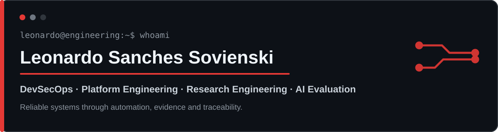

  

  
  

## Hi, I'm Leo — DevSecOps, Platform Engineering & Independent Research

Information Systems student at UNIFACEAR (expected Dec 2027), based in the Curitiba metropolitan area, Brazil. Former DevSecOps Intern at Volvo Group IT, where I was the only DevOps person on my team, handling delivery end to end, from requirements and CI/CD to deployment and production troubleshooting.

I build delivery systems people can trust: pipelines as code, no hardcoded secrets, idempotent automation, build once and deploy the same artifact, and claims backed by evidence.

🟢 **Open to:** internship or junior roles in DevSecOps, DevOps, Platform Engineering, Cloud, CI/CD and .NET · research collaborations and fellowships

📍 Curitiba, PR · on-site, hybrid or remote · open to relocation

🗣️ Portuguese (native) · English (advanced, TOEIC 810)

---

## Experience

**DevSecOps Intern — Volvo Group IT** · Sep 2025 – Sep 2026

* Only DevOps person on the team, handling delivery demands end to end
* Took 3 internal applications from no maturity level to level 3 in Backstage Soundcheck/QualityCheck, finding and fixing the gaps
* Designed and implemented a unified CI/CD pipeline used by about 15 .NET applications, with SonarQube and Sonatype Nexus IQ as blocking or report-only gates per branch
* Built end-to-end CI/CD for a new .NET 10 backend with Azure Functions and an Angular frontend, integrating SonarQube, Fortify, Nexus IQ and JMeter load tests
* Migrated pipelines from Azure DevOps to GitHub Actions
* Azure deployments (Web Apps, Functions) across DEV, ACC and PROD with Key Vault, Entra ID, health checks and configuration backups
* Observability with Azure Monitor, Application Insights, Log Analytics and Diagnostic Settings
* Diagnosed silent failures: checks that passed without measuring what they were supposed to, documented as reusable runbooks

> My public repositories are personal or academic projects. They do not contain or represent proprietary company code.

---

## Projects

### Public — code available

**[CV Registration System](https://github.com/leonardosovienski/curriculos-ciee)** · `React` · `ASP.NET Core` · `EF Core` · `SQL Server` · `Docker` · `GitHub Actions`

Full-stack résumé registration system with PDF parsing, backend validation, ASP.NET Core, React, EF Core and SQL Server. Includes automated API/integration tests, Dockerized local infrastructure and GitHub Actions CI.

**[Job Screening and CV Automation](https://github.com/leonardosovienski/automatizacao-curriculo)** · `Python` · `Pydantic` · `LLM APIs`

CLI that collects, validates, deduplicates and ranks job postings, combining deterministic rules with LLM output that is checked against source evidence. Includes caching, retries, circuit breakers and privacy controls.

**[Velour](https://github.com/leonardosovienski/Velour)** · `FastAPI` · `React` · `TypeScript` · `SQLAlchemy` · `JWT` · `pytest`

Academic salon management system with authentication, role-based access control, scheduling, loyalty, inventory, dashboards and automated tests.

### Research — private code, public evidence

**[Prediction Research Programme — Public Evidence Pack](https://github.com/leonardosovienski/ecosystem-predictor)** · `Python` · `Pre-registration` · `Temporal integrity` · `Reproducibility`

Public evidence pack for an independent multi-repository research programme spanning football, equities and crypto. The programme evolved from prediction systems into research on evaluation reliability, using pre-registration, temporal-integrity tests, qualification attestations, documented negative results and explicit limitations. Several hypotheses were refuted and closed rather than promoted as successful results. Includes the methodological core of my undergraduate thesis.

**CAIN — Auditable AI-assisted research**

Independent research project on AI-assisted research that is auditable, verifiable and reproducible, keeping experimentation, evidence and decisions separate. The agent proposes experiments but never gains authority over evaluation, data or budget; its authority boundaries are implemented and integration-tested with the three domains above. Working local prototype; the open scientific question is proposed, not yet run.

The implementation repositories are private to protect ongoing research. The public evidence pack above is the entry point; a technical report and a guided code walkthrough are available on request.

---

## Stack

* **CI/CD & DevSecOps** — `Azure DevOps` · `GitHub Actions` · `YAML` · `SonarQube` · `Fortify` · `Nexus IQ` · `JMeter`
* **Cloud & Observability** — `Azure App Service` · `Azure Functions` · `Key Vault` · `Entra ID` · `Azure Monitor` · `Application Insights` · `Log Analytics` · `Terraform`
* **Platform** — `Backstage` · `Docker` · `uv`
* **Development** — `Python` · `C#` · `.NET` · `FastAPI` · `ASP.NET Core` · `React` · `TypeScript` · `SQL Server` · `PostgreSQL`
* **Practices** — `Automated testing` · `Runbooks` · `Contracts` · `Reproducibility` · `Documentation`

---

## Education

* 🎓 B.Sc. in Information Systems — UNIFACEAR (expected Dec 2027)
* 📚 Microsoft Azure Fundamentals (AZ-900) — course completed, certification exam in preparation

---

## Recognition

* 🏆 Winner — 1st UNIFACEAR Hackathon (2025)
* 🥈 Silver medal — OBMEP (Brazilian Mathematics Olympiad for Public Schools)

---

🌎 Em português

Estudante de Bacharelado em Sistemas de Informação na UNIFACEAR (conclusão prevista em dez/2027), na região de Curitiba. Ex-estagiário de DevSecOps na Volvo Group IT, onde fui o único profissional de DevOps do time e cuidei das entregas de ponta a ponta. Aberto a vagas de estágio ou júnior em DevSecOps, DevOps, Cloud, CI/CD e .NET, e a parcerias de pesquisa. Contato: leonardo.sovienski@gmail.com

<b>Reliable systems through automation, evidence and traceability.</b>

